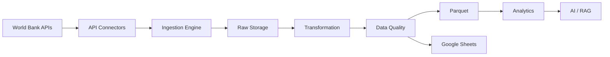

# Architecture

## Layers

| Layer | Module | Responsibility |
|---|---|---|
| Connectors | `connectors/` | One class per API; `BaseConnector` + registry. New API = new connector, no pipeline changes. |
| Ingestion | `ingestion/` | `Extractor` orchestration, `Paginator` (page + cursor styles), tenacity retries, `StateStore` for FULL/INCREMENTAL/BACKFILL. |
| Transformation | `transformation/` | Pydantic schemas, normalizer (raw → records), standardizer (types, dedupe keys). |
| Quality | `quality/` | 5-dimension validator → `quality_score`; profiler; expectations per dataset. |
| Storage | `storage/` | Raw JSON landing, Parquet curated, TTL file cache. |
| Sheets | `google_sheets/` | `GoogleSheetsWriter`; transport abstraction (service-account/gspread or connector CLI). |
| Metadata | `metadata/` | Source + data-product catalog, lineage tracker, JSONL audit log. |
| Analytics | `analytics/` | Trends (YoY, CAGR), correlations, rankings, IQR outliers, NL summaries. |
| Visualization | `visualization/` | Plotly charts, single-file HTML dashboard. |
| Pipeline | `pipeline.py` | Orchestrates extract → quality → store → publish. |
| CLI | `cli/main.py` | click commands. |

## Data flow (one ingestion)

`Connector.fetch()` → raw JSON landed in `data/raw/<source>/<run_id>/` →
`Normalizer` (Pydantic) → `Standardizer` (types/dedupe) → `Validator` (score) →
Parquet in `data/processed/<source>/<run_id>.parquet` → Sheets worksheets →
lineage + audit records.
